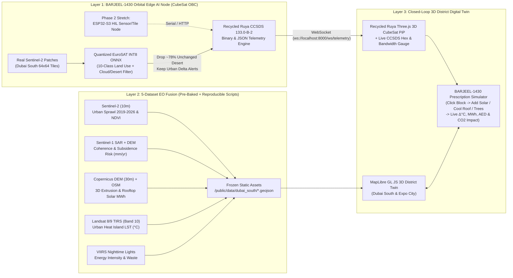

# Mission BARJEEL-1430 (برجيل): Orbital Edge AI & Closed-Loop Sustainability Twin

**Competition**: Supernova × SpacePoint — **Theme 02: Cities from Orbit** (*Smart and sustainable urban living*)  
**Submission Deadline**: **Today, 7:00 PM GST (+04:00)**  
**Deliverables**: Runnable GitHub Repository + Live/Pitch Deck (PPT)  
**Target Area of Interest (AOI)**: **Dubai South & Expo City Corridor** (`[55.120°E, 24.880°N]` to `[55.240°E, 24.980°N]`)

---

## 1. Strategic Mission Framing (Why BARJEEL-1430 Is a Space Mission, Not Just a Dashboard)

> [!IMPORTANT]
> **Why "BARJEEL-1430"?**  
> - **Barjeel (برجيل)**: The iconic Emirati wind tower—centuries-old passive urban cooling engineering built for sustainable desert living.  
> - **1430 (2:30 PM GST)**: Public sun-synchronous satellites (`Sentinel-2`, `Landsat 8/9`) cross the UAE at **~10:30 AM local solar time**—completely missing **14:30 GST peak urban heat island stress** and peak AC grid demand—while wasting **~78% of downlink bandwidth** transmitting static desert and cloud-covered pixels.  
> **Mission BARJEEL-1430** is a **closed-loop Space-to-Street Urban Sustainability Mission**: multi-satellite EO fusion today (Phase 1) scaling to an inclined-LEO **3U Edge-AI Thermal & Multispectral CubeSat** targeting the **14:30 GST thermal peak** (Phase 2) that filters imagery in orbit, prescribes block-level cooling/solar fixes, and **verifies climate impact from space**.

---

## 2. Phased Mission Roadmap & Objective Sustainability Goals (KPIs)

| Mission Phase | Horizon & TRL | Operational Scope | Objective, Verifiable Mission Goals (KPIs) |
| :--- | :--- | :--- | :--- |
| **Phase 0: Ground & Orbital Bench** *(Today's Prototype)* | **Now (TRL 4)** | Fuse `Sentinel-1/2`, `Landsat 8/9`, `VIIRS`, `Copernicus DEM` over **Dubai South & Expo City** + Software CubeSat OBC (`EuroSAT` INT8 ONNX + `CCSDS 133.0-B-2`) + `ESP32-S3` HIL bench. | • **$\ge 75\%$ downlink bandwidth reduction** by discarding static desert/cloud tiles on-board.<br>• **`< 15 ms`** per-tile Edge AI inference latency.<br>• **100% coverage** of all 4 Theme 02 prompts in one runnable 3D Twin. |
| **Phase 1: Municipal Prescription Pilot** | **Months 1–12 (TRL 6)** | Automated STAC pipeline integrated with **Dubai Municipality**, **Expo City Sustainability**, and **DEWA Shams Dubai** solar program. | • Map **$350\text{ MWp}+$ rooftop solar capacity** across Dubai South logistics mega-warehouses ($\approx 280,000\text{ tCO}_2/\text{yr}$ offset).<br>• Prescribe cool-roof & Barjeel shade corridors on top 15 heat-island blocks to achieve **$-2.5^\circ\text{C}$ Land Surface Temp ($\Delta\text{LST}$)**.<br>• Cut **18% wasted nighttime radiance** (`VIIRS`) in under-occupied logistics zones. |
| **Phase 2: *BARJEEL-1430* 3U Pathfinder CubeSat** | **Months 12–24 (TRL 7–8)** | Launch a university-built **3U CubeSat** ($37^\circ$ inclined LEO) with uncooled LWIR thermal + multispectral imager & Edge AI SoC timed for **14:30 GST UAE peak heat**. | • Capture **afternoon thermal peak ($14:00\text{–}16:00\text{ GST}$)** missed by sun-synchronous satellites.<br>• **`< 90 min` orbital alert-to-dashboard latency** via priority CCSDS packets.<br>• Flag **$> 3.0\text{ mm/yr}$ ground settlement zones** (`Sentinel-1` + DEM) 6 months before structural cracking. |
| **Phase 3: GCC Net-Zero Constellation** | **Years 2–4 (TRL 9)** | 3-CubeSat pocket constellation auditing urban sustainability compliance across **Dubai, Abu Dhabi, Sharjah, Riyadh, and Doha**. | • Continuous **Space-Verified ESG & Carbon Credit Auditing** (verifying from orbit that cool roofs, greening, and solar panels were built and lowered $\text{LST}$). |

---

## 3. System Architecture & Recycled Assets



---

## 4. Frozen Data Contracts (Zero Integration Bugs at 5 PM)

### Contract A: Bounding Box & Anchor Landmarks (`contracts/dubai_south_aoi.json`)
- **AOI Bounding Box (`[minLon, minLat, maxLon, maxLat]`)**: `[55.1200, 24.8800, 55.2400, 24.9800]`
- **Default Camera Center**: `[55.1510, 24.9600]` (`pitch: 58`, `bearing: 135`, `zoom: 13.8`).
- **4 Named District Zones**:
  1. `expo-core`: **Expo City Sustainability Benchmark** (`[55.151, 24.960]`)
  2. `logistics-mega`: **Dubai South Logistics Corridor** (`[55.168, 24.918]`) — #1 Solar ROI zone
  3. `residential-growth`: **Dubai South Residential Boom Zone** (`[55.205, 24.942]`) — fastest 2019→2026 sprawl + heat island hotspot
  4. `aviation-infra`: **Al Maktoum Northern Infrastructure Perimeter** (`[55.165, 24.902]`) — heavy load SAR subsidence corridor

### Contract B: `frontend/public/data/dubai_south/buildings_3d.geojson`
```json
{
  "id": "bldg_1042",
  "zone_id": "logistics-mega",
  "name": "Logistics Hub Warehouse B4",
  "height_m": 16.5,
  "roof_area_m2": 14200,
  "land_use_class": "Industrial",
  "growth_year": 2023,
  "lst_celsius": 47.8,
  "subsidence_mm_yr": -2.4,
  "sar_coherence": 0.84,
  "solar_kwh_yr": 2982000,
  "solar_capacity_kwp": 1704,
  "viirs_radiance": 42.5,
  "prescription": "SOLAR_AND_COOL_ROOF",
  "priority_score": 94
}
```

### Contract C: WebSocket Telemetry `ws://localhost:8000/ws/telemetry`
```json
{
  "ccsds_header_hex": "0801C04A003F",
  "met_ms": 148000,
  "source": "SIM_OBC",
  "flight_mode": "NOMINAL_EO_SCAN",
  "solar_local_time": "14:30 GST",
  "adcs": { "q0": 0.98, "q1": 0.12, "q2": -0.08, "q3": 0.11, "nadir_locked": true },
  "edge_ai": {
    "tile_id": "S2_24918_55168",
    "lat": 24.918,
    "lon": 55.168,
    "predicted_class": "Industrial",
    "confidence": 0.96,
    "inference_ms": 6.4,
    "action": "DOWNLINK_PRIORITY_ALERT",
    "bandwidth_saved_pct": 78.4,
    "change_detected": true
  }
}
```

---

## 5. 7-Hour Crunch Schedule (12:00 PM → 7:00 PM GST)

| Time Window | Milestone | Gate Check |
| :--- | :--- | :--- |
| **12:00 – 12:20** | **Repo Push & Clone**: Push initialized monorepo with starter mock `buildings_3d.geojson` (180 buildings) + TypeScript contracts (`src/types/contracts.ts`). | All 4 builders pull `main`. |
| **12:20 – 14:30** | **Parallel Core Sprint** (B1 Backend Edge AI, B2 Real Satellite Pipeline, B3 MapLibre 3D Twin, B4 Ruya CubeSat HUD + Planner, B5 Pitch Slides 1–7). | Real `buildings_3d.geojson` + S2 patches committed by **14:30**. |
| **14:30 – 16:15** | **Integration & Closed-Loop Polish**: Live orbital scan pings on 3D map + interactive prescription toggles updating 3D roofs & KPI counters. | Single-script end-to-end software MVP live by **16:15**. |
| **16:15 – 17:30** | **Screenshot Harvest for PPT + Stretch `ESP32-S3` HIL**: B5 grabs high-res visuals; B1 hooks up `ESP32-S3` (`"source": "ESP32_S3_HIL"`). | Hard feature freeze at **17:30**. |
| **17:30 – 18:30** | **Judge-Proofing**: Second-laptop clean startup test, crisp `README.md`, export PPTX + PDF backup. | Repo `< 50 MB`, `< 60s` boot. |
| **18:30 – 19:00** | **Portal Upload Buffer**: Submit GitHub Repo + Pitch Deck 25 mins early. | **SUBMITTED!** |

---

## 6. Copy-Paste Antigravity Prompts for Teammates

### 👤 Member 1 (You): Orbital Edge AI & CCSDS OBC (`backend/`)
*(Executing directly in this workspace!)*

### 👤 Member 2: Satellite EO Data & Geospatial Pipeline Lead (`data_pipeline/`)
```text
You are Member 2 working ONLY inside `data_pipeline/` and outputting to `frontend/public/data/dubai_south/` and `backend/data/s2_patches/` for Mission BARJEEL-1430. Read `contracts/dubai_south_aoi.json` and `frontend/src/types/contracts.ts` first — DO NOT change the existing property names in `buildings_3d.geojson`!
Build `data_pipeline/fetch_real_dubai_south.py` using open STAC APIs (`pystac-client` + `planetary-computer` + OpenStreetMap Overpass API, zero paid API keys):
1. Fetch real OpenStreetMap building footprints inside `[55.1200, 24.8800, 55.2400, 24.9800]` (Dubai South & Expo City), falling back cleanly or merging with warehouse/Expo footprints if sparse, capped to ~1,500–3,000 clean polygons (< 12 MB GeoJSON).
2. Enrich every building polygon by sampling real satellite layers over the bbox:
   - Sentinel-2 L2A (2019 vs 2024/2025): compute NDVI & NDBI delta to assign `growth_year` (2019..2026) and export 30 real 64x64 RGB PNG tiles into `backend/data/s2_patches/` named `S2_{lat}_{lon}_{hint}.png`.
   - Landsat 8/9 Collection 2 Level-2 Surface Temperature: convert to Celsius (`lst_celsius`).
   - Copernicus DEM GLO-30: sample elevation/slope and compute rooftop solar (`solar_capacity_kwp = roof_area_m2 * 0.65 * 0.20`, `solar_kwh_yr = solar_capacity_kwp * 1750`).
   - Sentinel-1 RTC SAR multi-temporal backscatter + DEM geotechnical load proxy: compute `sar_coherence` (0..1) and `subsidence_mm_yr` (check ASF API first with a 10-min timeout, otherwise use documented SAR amplitude + load proxy).
   - VIIRS Nighttime Lights: sample `viirs_radiance`.
3. Assign `zone_id` (`expo-core`, `logistics-mega`, `residential-growth`, `aviation-infra`), `priority_score` (0-100), and `prescription` (`SOLAR_ARRAY`, `COOL_ROOF_CORRIDOR`, `GEOTECH_AUDIT`, `SMART_DIMMING`, `SOLAR_AND_COOL_ROOF`), and overwrite `frontend/public/data/dubai_south/buildings_3d.geojson` and `district_summary.json`. Also export aligned raster PNG overlays (`landsat_lst.png`, `sentinel2_rgb.png`) if fast.
```

### 👤 Member 3: 3D District Digital Twin & Shader Lead (`frontend/src/components/DistrictMap/`)
```text
You are Member 3 working ONLY inside `frontend/src/components/DistrictMap/` for Mission BARJEEL-1430. Read `frontend/src/types/contracts.ts` and `contracts/dubai_south_aoi.json` first — keep the `DistrictMapProps` interface in `DistrictMap.tsx` intact so Member 4's HUD integrates with zero merge conflicts!
Build an ultra-slick 60 FPS 3D WebGL Digital Twin of Dubai South & Expo City using `maplibre-gl`:
1. Initialize the map at `[55.1510, 24.9600]` (`pitch: 58`, `bearing: 135`, `zoom: 13.8`) with a toggle between CARTO Dark Matter (cyberpunk mission mode) and Esri World Satellite Imagery, plus 3D terrain / sky atmosphere.
2. Render `/data/dubai_south/buildings_3d.geojson` as a 3D `fill-extrusion` layer (`height_m`) that smoothly transitions colors based on `activeLayer`:
   - `growth`: color by `growth_year` (2019–2026) and filter `growth_year <= selectedYear` so dragging the timeline slider grows Dubai South in 3D!
   - `insar`: emerald (`0 mm/yr`) -> amber (`-2 mm/yr`) -> crimson (`< -4 mm/yr` subsidence risk).
   - `solar`: deep slate -> glowing gold/amber scaled by `solar_kwh_yr`.
   - `thermal`: cool cyan (`36°C`) -> orange -> intense crimson (`49°C+` heat islands).
   - `viirs`: midnight blue -> neon magenta/white scaled by `viirs_radiance`.
3. Visually reflect `appliedPrescriptions`: buildings in zones/IDs where Solar, Cool Roof, or Dimming are toggled ON immediately shift to a sleek cyan/emerald "Mitigated" highlight shader!
4. Render a pulsing orbital target reticle at `latestTelemetry?.edge_ai` (`lat`, `lon`), support smooth `flyTo` for the 4 Dubai South preset zones (`activeZone`), and trigger `onSelectBuilding(props)` with a sleek hover/click tooltip when a 3D building is clicked.
```

### 👤 Member 4: Recycled Ruya 3D CubeSat HUD + BARJEEL-1430 Sustainability Planner (`frontend/src/components/HUD/`)
```text
You are Member 4 working ONLY inside `frontend/src/components/HUD/` and `frontend/src/hooks/` for Mission BARJEEL-1430. Read `frontend/src/types/contracts.ts` first — do NOT edit `src/components/DistrictMap/` so you never conflict with Member 3!
Build the Aerospace Mission Control HUD & Closed-Loop Sustainability Prescription Simulator:
1. `OrbitalTwinPiP.tsx`: Port our Ruya Three.js 3U CubeSat Digital Twin (aluminum chassis `BoxGeometry`, left/right solar wings, thermal radiator mesh changing blue/amber/crimson, quaternion attitude `setRotationFromQuaternion`, rotating wireframe Earth) into a collapsible glassmorphic Picture-in-Picture corner card.
2. `useTelemetryStream.ts`: Connect to `ws://localhost:8000/ws/telemetry` with an automatic seamless fallback to an internal realistic 1 Hz Dubai South orbital scan generator if port 8000 is offline (so the frontend NEVER fails in demos!). Show live `CCSDS 133.0-B-2` hex packet headers, `14:30 GST` local pass badge, Edge AI predicted class & inference ms, Downlink Bandwidth Saved % (~78%), source badge (`SIM_OBC` vs `ESP32_S3_HIL`), and Uplink Command buttons (`POST http://localhost:8000/api/command`).
3. `MissionHUD.tsx` & `PrescriptionSimulator.tsx`:
   - Top bar: Mission BARJEEL-1430 branding, Mission Phase switcher (`Phase 1: Municipal STAC`, `Phase 2: BARJEEL-1430 3U Afternoon-Heat CubeSat`, `Phase 3: GCC Net-Zero Constellation`), Layer Mode pills (`01 Growth`, `02 InSAR`, `03 Solar`, `04 14:30 Heat`, `05 VIIRS`), 2019–2026 Year Slider, and 4 Zone Fly-To buttons.
   - Right/Left glassmorphic **Closed-Loop Prescription Panel**: displays selected building/zone satellite diagnostics and 3 interactive intervention switches (**Deploy Shams Rooftop Solar**, **Apply Barjeel Cool-Roof & Shade Corridor**, **Smart VIIRS Streetlight Dimming**) that dynamically animate district-wide KPI impacts (`Δ Surface Temp -2.5°C`, `GWh/yr Clean Power`, `AED Saved`, `tCO2 Avoided`) and update `appliedPrescriptions`.
```

### 👤 Member 5: Pitch Deck Blueprint (10 Slides — Mission BARJEEL-1430)
1. **Title**: *BARJEEL-1430 (برجيل): Ancient Emirati Cooling Wisdom Meets Autonomous Orbital AI* — Theme 02: Cities from Orbit.
2. **The 14:30 Blindspot**: Rapid UAE urban growth creates $+6^\circ\text{C}$ heat islands & soil load stress—yet public sun-synchronous satellites pass at **10:30 AM**, missing **14:30 GST peak heat**, while wasting **78% of downlink** on static desert/clouds.
3. **Closed-Loop Mission Architecture**: *1. Sense & Filter in Orbit (Edge AI)* → *2. Diagnose (5-Satellite Fusion)* → *3. Prescribe (3D Twin)* → *4. Verify from Space (ESG Audit)*.
4. **Orbital Edge AI + CCSDS Downlink**: Quantized `EuroSAT` INT8 ONNX (`<10 ms`) + `CCSDS 133.0-B-2` framing + `ESP32-S3` HIL bench = **78% bandwidth saved**.
5. **5-Dataset Fusion Over Dubai South & Expo City**: `Sentinel-2` (Sprawl), `Sentinel-1` (SAR Subsidence), `Copernicus DEM` (Solar), `Landsat 8/9` (Thermal LST), `VIIRS` (Night Energy).
6. **Live Prototype: 3D Prescription Twin + CubeSat PiP HUD**: Full-bleed UI visual + What-If ROI simulator.
7. **Dubai South Case Study Numbers**: Mega-warehouse MWp solar unlocked, Expo Core vs. sprawl $\Delta\text{LST}$, Al Maktoum corridor stability watch.
8. **Phased Mission Roadmap (TRL 4 → TRL 9)**: Phase 0 Bench → Phase 1 Dubai Municipality/DEWA Pilot → Phase 2 *BARJEEL-1430* 3U $37^\circ$-Inclined Afternoon CubeSat → Phase 3 GCC Constellation.
9. **UAE Strategic Fit & Business Model**: Dubai 2040 Master Plan + UAE Net Zero 2050 + DEWA Shams Dubai; B2G SaaS + Space-Verified Carbon Auditing.
10. **Summary & Live Demo QR**: Measurable KPIs (`-2.5°C ΔLST`, `78% downlink saved`, `350+ MWp solar mapped`).
